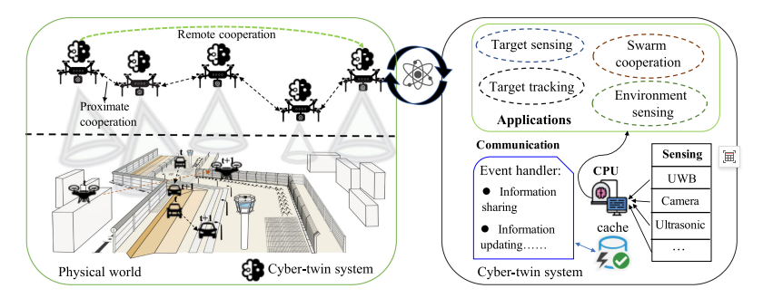
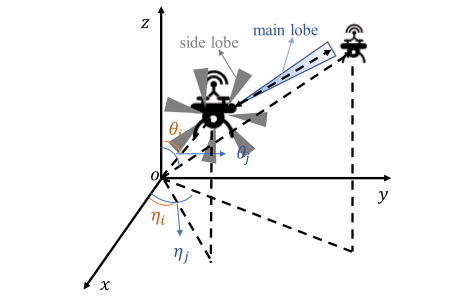
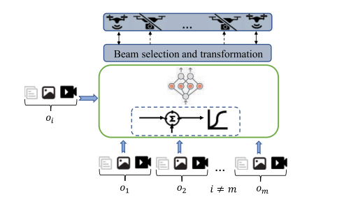
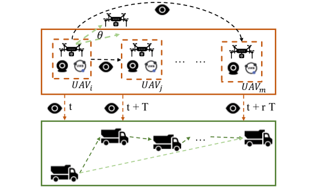
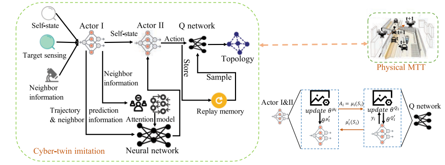
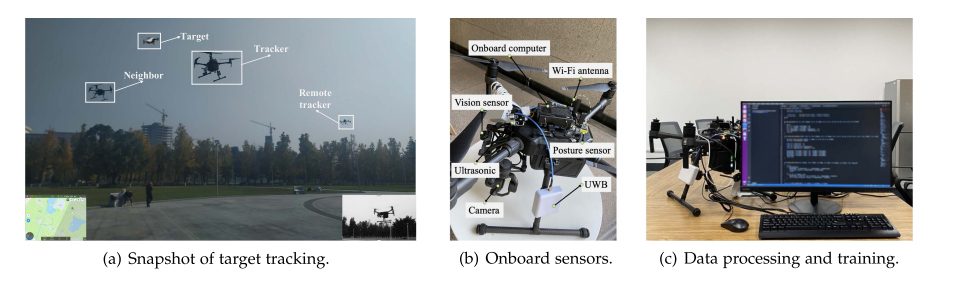
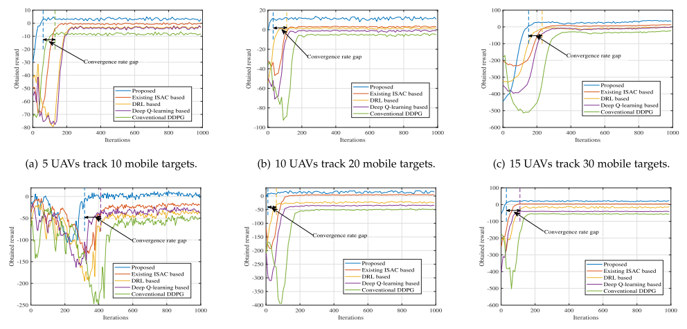
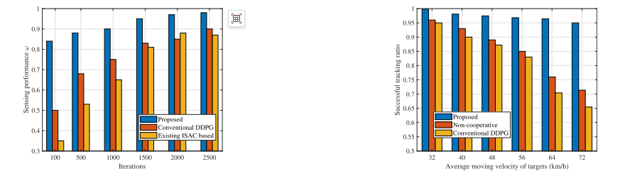

# [Drone Collaboration] Integrated Perception and Communication Technology for Multi-Object Tracking in Drone Swarms

1. Abstract
Driven by the intelligentization of the Internet of Things (IoT), a variety of interconnected IoT devices are emerging, achieving efficient interactions with the physical world. Against this backdrop, multi-target tracking (UAV-MTT) technology based on UAV flocks has become a research hotspot. This technology can perceive and track moving targets, which can be applied to scenarios such as hit-and-run pursuit. However, due to the complex road network environment, it is difficult for UAVs to achieve real-time multi-target tracking through traditional centralized models; moreover, in distributed architectures, achieving low-cost UAV flock coordination for real-time multi-target tracking also faces challenges.
To address these issues, this paper proposes a distributed tracking algorithm based on digital twins for updating and optimizing trained digital models to support real-time multi-target tracking. Subsequently, a distributed collaborative tracking framework is designed to enhance multi-target tracking performance. In the framework design, by integrating perception and communication resources, the first real-time short and long-distance distributed tracking collaboration method with low communication energy consumption is achieved. The integration of resources not only reduces energy consumption but also improves target perception efficiency, significantly enhancing tracking success rates.
Theoretical derivations prove the convergence of the proposed algorithm, and hardware-in-the-loop simulation results show that compared to other benchmark algorithms, this algorithm can significantly reduce 65.7% of communication energy consumption while effectively improving perception performance by 20.0%.
2. Introduction
UAVs, as common flying vehicles, can be controlled autonomously through onboard computers for flexible flight. With their multifunctional and low-cost advantages, UAVs can successfully complete tasks in various scenarios such as hit-and-run pursuit and emergency rescue. Against the backdrop of artificial intelligence (AI) technology, the application of multi-target tracking (UAV-MTT) based on UAV flocks is becoming increasingly popular. In scenarios like border patrol and space exploration, there is an urgent need for UAV flocks to collaborate in search and tracking. UAV flocks can not only expand network coverage but also optimize data collection processes. Taking the hit-and-run scenario as an example, UAVs can detect moving targets affecting traffic safety through environmental observation and transmit observation information to the control center. The control center then formulates tracking decisions and guides UAVs to automatically associate and track moving targets.
The traditional centralized model typically places the decision-making center at base stations, which results in long physical transmission distances that prevent drones from obtaining tracking strategies in a timely manner. The distributed model shortens transmission distances through information exchange between neighbors, but this interaction approach poses new challenges for multi-object tracking: firstly, when targets exceed the current range of a drone, triggering information exchange can be difficult to ensure real-time tracking of fast-moving targets; secondly, sensors such as onboard cameras and lidar, due to their overlapping perception ranges, lead to high levels of redundancy, increasing communication energy consumption, and subsequently impacting real-time tracking performance; thirdly, heterogeneity and volume of information collected by sensors like onboard cameras and lidars can easily result in high transmission delays; fourthly, the flexible mobility of targets also demands higher real-time tracking requirements.
Fortunately, artificial intelligence technology offers the possibility of real-time processing heterogeneous data, achieving low-latency communication, and enhancing collaborative tracking performance. AI methods enable drones to autonomously learn optimal tracking collaborative strategies, associate the best moving targets in real-time based on inter-neighbor interaction information, and assist in formulating and optimizing collaborative tracking decisions. However, in large-scale drone network systems, achieving decision consensus with low communication overhead remains challenging. Digital twin-based AI technology may be a viable solution for meeting low-communication costs and realizing real-time collaborative multi-object tracking.
To this end, this paper first designs a distributed collaborative tracking framework based on integrated perception and communication (ISC) technology to achieve remote collaboration of unmanned aerial vehicles (UAVs). Subsequently, it proposes a distributed tracking algorithm based on digital twins to reduce tracking latency and enhance target perception capabilities. This supports UAVs in adaptively adjusting antenna beams, sharing learning information under interference-free conditions, and ensuring the reliability of interaction.
In the future, the research team will combine centralized and distributed models to enhance the flexibility of the tracking framework, introducing edge servers such as flying base stations. This flexible framework can be managed centrally, assisting in allocating computational resources for distributed multi-target tracking. In this context, the digital twin model can further optimize towards lightweight directions, while also managing comprehensive data through local centralized management. Additionally, optimizing the data required for real-time information interaction will also become one of the future research directions.

## Images

<!-- PAYMENT_BLOCK -->

## Get this dataset

- Payment link (Stripe): [Buy now](https://buy.stripe.com/3cs8yP7sY87d0vu9AB)
- Payment QR code: 

<!-- /PAYMENT_BLOCK -->
